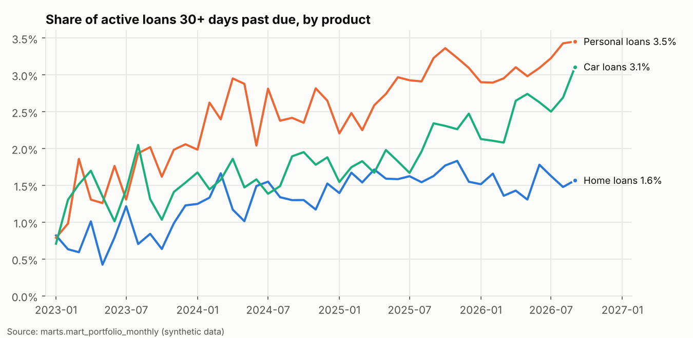
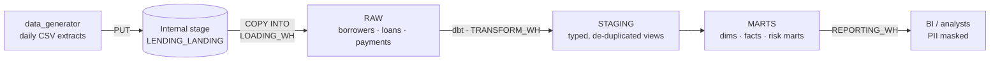
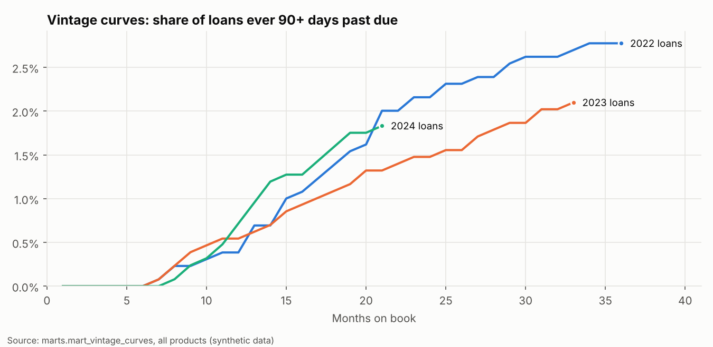

# Snowflake Lending Warehouse


An end-to-end data warehouse for a consumer lender, built on **Snowflake** and **dbt**.
It takes daily extracts from a lending system (borrowers, loans, repayments), loads them
with `COPY INTO`, and models them into the tables a credit risk team reports from:
month-end loan positions, days-past-due buckets, portfolio arrears rates and vintage curves.

The data is synthetic (5,000 borrowers, 6,000 loans, 165,000 repayments over 2022–2026),
generated with realistic arrears, catch-up payments, prepayments, defaults and duplicate
source records. The same dbt project also runs on DuckDB, so CI tests every model on every
push without needing a Snowflake account.



## Architecture



| Layer | Schema | Built by | What it holds |
|---|---|---|---|
| Landing | `RAW` stage | `loader/load.py` | Compressed CSV files, one payments file per month |
| Raw | `RAW` | `COPY INTO` | Source columns as delivered, plus `_SOURCE_FILE` and `_LOADED_AT` |
| Staging | `STAGING` | dbt views | Typed, cleaned, de-duplicated; contractual instalment calculated |
| Marts | `MARTS` | dbt tables | `dim_borrower`, `dim_loan`, `fct_payments`, `fct_loan_monthly_snapshot`, `mart_portfolio_monthly`, `mart_vintage_curves` |

## What it shows

**Snowflake**
- **Separate warehouses** for loading, transformation and reporting, all XSMALL with 60-second auto-suspend, so workloads don't queue behind each other and cost shows per workload.
- **Resource monitor** that notifies at 75% and suspends at 100% of a monthly credit quota.
- **Role-based access**: `LOADER` writes RAW only, `TRANSFORMER` builds STAGING and MARTS, `ANALYST` reads MARTS only. Future grants keep new tables covered.
- **Dynamic data masking** on borrower names, email and date of birth. Analysts see `***MASKED***`, the email domain only, and the birth year; `PII_READER` sees full values. dbt re-attaches the policies after each rebuild.
- **Idempotent `COPY INTO`** with file metadata captured per row. Re-running a load only picks up new files, and bad payment rows are skipped and reviewable with `VALIDATE`.
- **Clustering** of the monthly snapshot on `SNAPSHOT_MONTH`, plus **query tags** (`lending:load`, `lending:dbt`) and ready-made queries in `snowflake/05_cost_monitoring.sql` for credits per warehouse, time per workload and partition pruning.

**dbt**
- **Incremental fact** (`fct_payments`): each run processes only newly landed payments and merges on `payment_id`, so a payment the source re-sends updates the existing row instead of duplicating it.
- **Adapter-dispatched macros**: one `month_spine` macro compiles to `GENERATOR` on Snowflake and `RANGE` on DuckDB.
- **35 data tests**: keys, relationships, accepted values, and two reconciliation tests. Every distinct payment in RAW must reach the mart exactly once for the same total, and monthly collections in the snapshot must match the payments fact. Range checks keep portfolio rates between 0 and 1, and a warning flags any payment dated before its loan.

**Credit risk modelling**
- `fct_loan_monthly_snapshot`: one row per loan per month with scheduled vs actual repayments, arrears, instalments in arrears, DPD bucket (`CURRENT`, `1-30`, `31-60`, `61-90`, `90+`), estimated balance and account status.
- `mart_portfolio_monthly`: active book, balance, arrears and 30+/90+ DPD rates by product, the opening page of a credit risk pack.
- `mart_vintage_curves`: the cumulative share of each origination cohort that has ever been 90+ days past due, by months on book.



## Run it locally (no Snowflake needed)

```bash
python -m venv .venv && source .venv/bin/activate
make install
make build-local      # generate data -> load DuckDB -> dbt build (models + tests)
make docs             # dbt docs with the lineage graph
```

## Run it on Snowflake

A free 30-day [Snowflake trial](https://signup.snowflake.com/) is enough. A full load and build takes a few minutes on XSMALL warehouses.

1. In a Snowflake worksheet, run `snowflake/01_setup_account.sql` as `ACCOUNTADMIN`, then grant the three roles to your user (last lines of the file).
2. Run `snowflake/02_raw_layer.sql` as `LOADER` and `snowflake/04_governance.sql` as `TRANSFORMER`.
3. Locally:
   ```bash
   cp .env.example .env    # fill in account, user, password
   set -a && source .env && set +a
   make load-snowflake     # PUT + COPY INTO RAW
   make build-snowflake    # dbt build on TRANSFORM_WH
   ```
4. Check the masking: `USE ROLE ANALYST; SELECT * FROM LENDING.MARTS.DIM_BORROWER LIMIT 5;`
5. See where the credits went with `snowflake/05_cost_monitoring.sql`.

## Design decisions

- **RAW is append-only and keeps load metadata.** Any number in a mart can be traced back to the file and load time it came from, and a bad load can be identified and replayed.
- **De-duplication happens once, in staging.** The latest extract of a `payment_id` wins. Marts never see duplicates, and the reconciliation test proves nothing was lost.
- **The snapshot is a full rebuild, the payments fact is incremental.** Arrears depend on a running total over each loan's whole history, so the snapshot is rebuilt (cheap at this size, and clustered). Payments are append-heavy and large, so they load incrementally.
- **Loans stay in the snapshot after maturity** until the reporting date, so a final payment made after the maturity month, or arrears still owed on a matured loan, are counted. The reconciliation test caught this case during development.

## Simplifications

This is a portfolio project, so the credit maths is deliberately simple:
- Instalment *k* falls due *k* months after origination; arrears are scheduled repayments to date minus cumulative repayments.
- Days past due are estimated from instalments in arrears (one missed instalment = 1–30 days).
- The balance follows the amortisation schedule adjusted for arrears and prepayments; interest on arrears, fees and hardship arrangements are not modelled.

## Project layout

```
data_generator/generate.py   synthetic borrowers, loans and monthly payment files
loader/load.py               PUT + COPY INTO for Snowflake, or a local DuckDB load
snowflake/                   account setup, RAW layer, COPY INTO, masking, cost queries
dbt/models/staging/          sources, typed and de-duplicated views
dbt/models/intermediate/     loan-month spine, payments by loan-month
dbt/models/marts/            core dims/facts and risk marts
dbt/macros/                  month_spine (dispatched), PII masking, DPD bucket
dbt/tests/                   reconciliation and range tests
docs/                        README charts and the script that draws them
```

---
Built by [Christopher Lloyd Magno](https://www.linkedin.com/in/clmagno/), data engineer.
